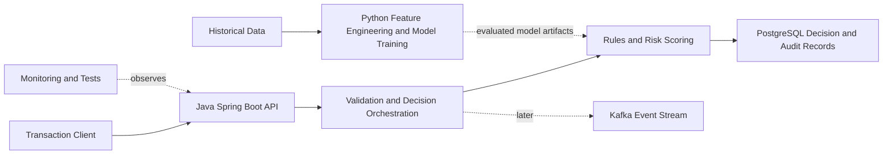

# Real-Time Fraud Detection System
[](https://github.com/Diivyaa2163/REAL-TIME-FRAUD-DETECTION/actions/workflows/ci.yml)


An educational engineering project for building a real-time transaction fraud-detection platform. The project will evolve incrementally from a tested API scaffold to explainable risk decisions, behavioural features, and model-assisted scoring.

## Current status

- [x] Spring Boot decision API scaffold generated.
- [x] Initial Maven test passed locally.
- [x] Repository foundation committed and pushed to GitHub.
- [ ] Automated tests running in GitHub Actions.
- [ ] Transaction request and response contract implemented.
- [ ] Deterministic fraud rules and decision explanations implemented.
- [ ] Persistent audit records and historical evaluation implemented.
- [ ] Python-based model training and evaluation added.
- [ ] Event streaming and operational monitoring evaluated and added where justified.

The initial passing test validates the generated application context only. It does not establish fraud-detection correctness, scalability, or production readiness.

## Planned architecture



This is the target architecture, not a claim that all components have been implemented. Kafka, PostgreSQL integration, model inference, and monitoring will be introduced incrementally.

## Technology direction

- Java and Spring Boot: synchronous transaction API and decision orchestration.
- Python: offline data processing, feature engineering, model training, and evaluation.
- PostgreSQL: durable decisions and audit records.
- Kafka: asynchronous events when justified by the design.
- Redis: optional, only if online feature access or measured latency needs it.
- GitHub Actions: automated build and test checks.

## Repository layout

- `services/decision-api/` — Java transaction decision API.
- `config/` — non-secret configuration templates.
- `docs/architecture/` — architecture and design documentation.
- `tests/` — tests for components added as the project evolves.

## Engineering principles

- Commit and push each meaningful, verified milestone.
- Never commit credentials, virtual environments, installed dependencies, or private financial data.
- Use simulated or appropriately licensed data.
- Test validation, failure handling, idempotency, and decision correctness.
- Measure latency and throughput instead of claiming scalability without evidence.

## Scope and safety

This is an educational prototype. It must not be connected to live payment authorization or used to make real financial decisions.

## Build and run locally

### Prerequisites

- Git
- JDK 25

The Maven Wrapper is included in the repository, so a separate
Maven installation is not required.

### Windows PowerShell

From the repository root:

```powershell
Set-Location "services/decision-api"
.\mvnw.cmd --batch-mode test
```

To start the Spring Boot application:

```powershell
.\mvnw.cmd spring-boot:run
```

When the application is running, check:

http://localhost:8080/actuator/health

Stop the application with Ctrl+C.

### macOS and Linux

From the repository root:

```bash
cd services/decision-api
./mvnw --batch-mode test
./mvnw spring-boot:run
```

## Current implementation scope

The repository currently contains the Spring Boot service scaffold.
The transaction decision API, fraud rules, database persistence,
and machine-learning inference will be implemented incrementally.